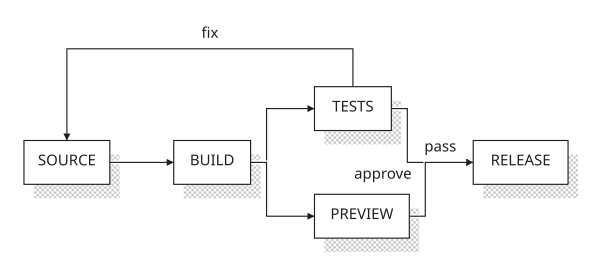

# Stipple

Stipple is a personal project I use to make diagrams for my writeups and portfolio
work.

It compiles text diagrams to SVG with labels, connections,
and stippled shadows. Requires Python 3.11 or later.

Install from a checkout:

```sh
python -m pip install .
```

Save a diagram as `flow.stip`:

```text
diagram "A release pipeline" {
    direction right
    gap 64

    source = box "SOURCE"
    build = box "BUILD"
    tests = box "TESTS"
    preview = box "PREVIEW"
    release = box "RELEASE"

    source -> build -> tests
    build -> preview
    tests -> release [label="pass"]
    preview -> release [label="approve"]
    tests.north -> source.north [label="fix", via=top, layout=false]
}
```



```sh
stipple flow.stip -o flow.svg
stipple --help
```

In Python, `from stipple import compile_svg` provides a function that takes the source
and returns SVG. Check `stipple.DiagramError` for compilation errors.

Code: [MIT](LICENSE). Bundled [Courier Prime](https://github.com/quoteunquoteapps/CourierPrime/tree/7fd585a2dd4c1612c79b3308e300923d1c13df93):
[SIL Open Font License](src/stipple/assets/OFL.txt).
